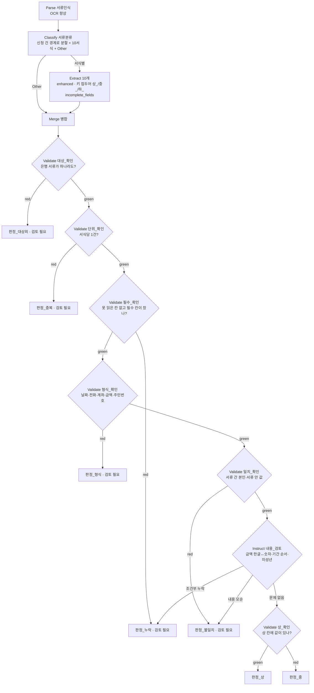

# iMASK 워크플로우 v2 계획 — 1차 온라인 심사 만점을 목표로

2026-11-06 작성. Claude 와 Codex(gpt-6-astra max)가 여덟 번 토의하고 Studio 에서 약 2,500번 돌려 확인한 결과다. 시험 워크플로우는 Studio `v2_full` 설정 60이고, 코드와 근거는 `.orchestration/workflow-v2/`(git 제외)에 있다. 운영 워크플로우와 팀원 워크플로우는 건드리지 않았다.

## 0. 결론

**항목별 위험도는 워크플로우 안에서 처리할 수 있고, 어렵지 않다.** 지금 워크플로우가 부실하게 느껴지는 이유는 프롬프트가 아니라 구조다. Instruct 는 Validate·Match 결과를 볼 수 없는데, 지금 위험도 판정은 그 결과를 읽는다고 가정하고 있다.

확정한 구조는 세 가지로 요약된다.

1. **Extract 키 이름에 등급을 넣는다**(`상_출금계좌번호`, `중_예금주_성명`). 기준표가 곧 스키마가 된다.
2. **Match 를 빼고 Validate 6개를 사슬로 잇는다.** 은행 서류인가 → 한 건씩인가 → 필수 칸을 읽을 수 있는가 → 형식이 맞는가 → 값끼리 맞는가 → 등급은 무엇인가. 판정이 규칙으로 정해지고, 걸린 단계가 곧 사유와 근거가 된다.
3. **갈래 끝 Instruct 7개가 같은 8키 JSON 을 낸다.** 판정값과 근거는 단일 enum 으로 고정하고, 모델은 값이 있는 칸 이름을 옮긴다.

**노드 27개, 데이터는 정예 21 케이스 · 문서 30건 · 5유형 · 10서식이다.** 제출 파일은 공식 이름과 양식으로 `.orchestration/workflow-v2/final_set/` 에 있다.

| | 지금 운영 설정의 사본 | 새 구조(최종 설정 60) |
|---|---:|---:|
| 위험 등급 일치 | 4/21 | 21/21 |
| 판정이 아예 없는 문서 | 5 | 0 |
| 검토 필요여야 하는 11건 중 검토 필요로 간 것 | 2 | 11 |
| 정상 10건 중 잘못 검토 필요로 간 것 | 1 | 0 |
| 항목별 등급 | 없음 | 있음 |
| 출력 8키가 전부 정답과 같은 케이스 | 키가 달라 비교 불가 | 21/21 |
| 노드 수 | 13 | 27 |
| 케이스(PDF) 1회 실행 시간 | 중앙 44초, 최대 73초 | 새 추출 중앙 50초, 최대 118초 |

운영 사본이 상·중에서 어긋나는 것은 기준표가 달라서이기도 하다. 그래도 판정이 사라지는 문서와 함정을 못 거르는 것은 기준표 차이로 설명되지 않는다. 표는 최종 설정으로 돌린 결과이고, 실행마다 조금씩 달라질 수 있다(§8).

**만점을 장담하지는 않는다.** 남은 것은 네 가지다.

1. **Library 사본을 아직 못 봤다.** 화면 내보내기에서는 구조화 출력이 유지되는 것을 실제로 확인했다(§10). Library 사본은 게시 창의 마지막 버튼이 '승인 요청' 하나뿐이라 승인 요청 없이는 시험할 수 없고, 사용자 지시로 지금은 게시하지 않는다. 안 되면 글 출력으로 바꾸는데, 목록 정확도가 크게 떨어진다(회귀 7건 중 2건만 일치).
2. **사람 검수가 남았다.** 정답은 Codex 가 원본과 전수 대조했지만 팀원 교차 검수 전이고, 등급 기준 일부는 임시 확정이다.
3. **모델이 틀리는 곳이 남는다.** 값 있는 칸을 목록에서 빠뜨리는 실수가 드물게 나온다(직전 판까지 포함한 최근 6회 126건 중 1건). 얼룩으로 가린 선택 칸은 실행마다 잡기도 놓치기도 해서 제출에서 뺐지만 약점은 그대로다.
4. **Upstage 일시 오류는 막을 수 없다.** 간결판 352회에서는 없었지만 이전 판을 합친 1,408회 중 11회(약 0.8%) 실패했고 다시 돌리면 정상이었다. 채점 때 걸리면 그 문서는 0점이다. 시간 제한도 공개되지 않았다.

구조(27노드, Match 제외)와 세트(21 케이스)는 사용자가 확정했고, 문서 등급 '하'는 일단 두지 않기로 했다. 남은 것은 §11 에 모았다. 워크플로우 적용과 라이브러리 게시는 전승환이 직접 한다.

## 1. 질문별 답

### Q1. "이름 = 중" 같은 항목별 등급을 워크플로우 안에서 처리할 수 있나?

**된다. 생각보다 어렵지 않다.** Validate 가 칸마다 등급을 써 주는 기능은 없지만, 세 가지를 묶으면 Studio 안에서 끝난다.

1. **Extract 키 이름에 등급을 넣는다** — `상_출금계좌번호`, `중_예금주_성명`, `하_작성일자`. 기준표가 키 이름 자체가 되어 프롬프트에 200줄짜리 표를 넣지 않아도 된다.
2. **Instruct 는 값이 있는 칸 이름만 옮겨 적는다** — "상_ 으로 시작하는 키 중 값이 있는 것을 `서류코드.칸이름` 꼴로". 판단이 아니라 복사다.
3. **구조화 출력으로 칸 이름을 enum 으로 묶는다** — 없는 이름을 지어낼 수 없다. 다만 enum 은 이름만 제한할 뿐, 값이 비어 있는 칸을 넣는 실수까지 막지는 못한다. 이 실수가 남은 오류의 대부분이다.

실측: 최종 설정으로 21 케이스를 세 번 돌려 3개 목록이 모두 정답과 같았다. 직전 판까지 포함하면 드물게 칸을 빠뜨린다(§8). 같은 방식을 기본 모델이 아닌 `solar-pro4` 로 돌리면 1/9 로 떨어진다. 모델은 기본(Auto)으로 둔다.

웹도 키 앞 글자로 항목 등급을 바로 읽으면 되므로 `risk_source: workflow` 로 표시할 수 있다(§10).

### Q2. Validate 로 무엇을 할 수 있나?

실제로 돌려 확인한 동작이다.

| 하고 싶은 것 | 쓰는 법 | 실측 |
|---|---|---|
| 칸이 비었는지 | `filled` / `empty` | 된다. 그 서류가 묶음에 없으면 값이 None: `filled` 실패, `empty` 통과 |
| 전화·날짜·계좌 양식 | `matches` + 정규식 | 된다. **전체 일치**이고 Python 정규식이라 lookahead 도 된다. 윤년까지 달력 검사 가능 |
| 조건 묶기 (where·and·or) | `{logic: and/or, conditions: […]}` 중첩 | 된다. 화면의 where 는 첫 조건 앞에 붙는 글자일 뿐 필터 기능이 아니다 |
| 크기 비교 (gt·gte·lt·lte) | 숫자끼리 | 숫자는 된다. **시험한 날짜 문자열 꼴에서는 실패**했다. 날짜 순서는 Instruct 내용_검토가 맡는다 |
| 같은 서류 안 두 칸 비교 | 오른쪽에 노드 참조 `eq`/`neq` | 된다. 단 없는 서류끼리 None eq None 은 통과하니 `서류 없음` 조건을 함께 둔다 |
| 다른 서류 칸끼리 비교 | **`path` 로만 된다** | 노드 참조 eq 는 값이 같아도 실패. `extract."코드"."키".value` 경로는 된다 |
| 표 칸 | `rowField` + `scope: any/all`, `agg: count/sum/min/max` | 된다 |
| 추출 신뢰도·글자 수 | `attr: confidence` / `length` | 된다. 단 빈 칸도 신뢰도가 0.95 안팎이라 신뢰도만으로 판독 불가를 가리지 못한다 |
| 위 단계 전체 읽기 | `path`(JMESPath) | `extract`, `classify.categories`, `parse.num_pages` 를 읽고 `length`·`contains`·`sort` 같은 함수를 쓴다. `nodes.…[].value` 는 null 이라 쓰지 않는다 |
| 판정 | severity error 실패 → red, warning 실패 → yellow, 모두 통과 → green | 판정별로 다른 노드로 보낼 수 있다 |

**가장 중요한 제약: Validate 결과는 뒤 Instruct 에게 보이지 않는다.** 판정별 간선으로만 넘길 수 있다. 그래서 사유마다 Validate 를 나눠 사슬로 잇고, 갈래마다 Instruct 를 둔다. 어느 규칙이 걸렸는지 모델이 모르므로 근거 문장도 갈래에 고정했다. 어느 칸이 걸렸는지는 Validate 응답의 `checks` 에 남는다.

### Q3. Match 는 뭐고, 남겨야 하나?

Match 는 검사가 아니라 **조인**이다. 기준 Extract(anchor)의 값과 같은 값을 다른 Extract 나 저장된 표(target)에서 찾아 붙인다.

- 빈 값 검사 도구가 아니다. 빈 값끼리도 일치로 나온다. 이름이 비었는지는 Validate `filled` 가 맡는다.
- **기준 서류가 묶음에 없으면 Match 가 아무것도 내지 않아 뒤 노드가 아예 돌지 않는다.** 응답은 completed 인데 판정 키가 없으니 그 케이스는 0점이다. 운영 사본에 제출 후보 21건을 돌려 보니 FATCA·위임장 단독 문서를 포함해 5건이 판정 없이 끝났다(은행 서류가 아닌 1건은 기타 안내로 빠진다).
- 이를 피하려고 Validate 를 앞에 두는 구조는 그래프 규칙이 거절한다(Match 앞은 Extract 또는 Merge 만). 한 경로에 Match 는 하나, 대상은 4개까지다.
- 서식 10종이 어떤 조합으로든 들어오는 우리 업무에는 "항상 있는 기준 서류"가 없다.
- **27노드에 실제로 넣어 돌려 봤다**(`v2_match`, 기준 소비자피해 + 대상 4서식, 21 케이스 1회). 판정이 나온 것은 8건이고 8키 전부 일치는 7건이다. 13건은 판정이 없다. 9건은 완료인데 Match 내용이 0개였고, 기준·대상 서식이 하나도 없는 4건은 오류(`server_error`)로 실패했다. 같은 세트에서 Match 없는 설정 60 은 3회 모두 21/21 이다.
- 저장된 표(Collection)와 대조하는 용도는 강력하지만, 운영진이 복사한 Library 사본에서 Collection 을 읽을 수 있는지 확인되지 않아 채점 경로에 넣지 않는다.

**결론: 제출 워크플로우에서 뺀다.** 서류 간 본인 대조는 Merge 뒤 Validate `path` 로 한다. Match 는 "청구서 ↔ 발주서"처럼 항상 짝으로 들어오는 업무에 맞는 노드다.

### Q4. 지금 워크플로우가 부실하게 느껴진 진짜 이유

1. **규칙이 작동하지 않고 있었다.** 위험도_판정 프롬프트의 "묶음_검증 결과가 red", "서류_대조에서 일치하지 않는 대상"은 Instruct 가 볼 수 없는 값이다. 지금까지는 모델이 추출값을 보고 스스로 짐작한 것이다.
2. **판정을 LLM 한 번에 모두 맡겼다.** 재실행 정확도(자동 25점)와 예외 처리(자동 15점)가 모델 변동에 그대로 노출된다.
3. **판정 키가 안 나오는 입력이 있다.** Match 기준 서류 없음, 은행 서류 아님 → 응답은 completed 인데 정답과 비교할 값이 없다.
4. **등급 기준이 두 벌이다.** 프롬프트는 옛 정보 종류 기준(계좌 = 중), 노션은 칸별 기준(계좌번호 = 상). 항목별 등급이 안 나오는 이유이기도 하다.
5. **형식 검사가 없다.** 달력에 없는 날짜, 주민번호 칸의 여권번호, 은행명·계좌 바뀜, 음수 금액을 그대로 통과시킨다. 김창민 자료가 바로 이런 함정이다.

숫자로 보면 더 분명하다. 운영 설정의 사본을 제출 후보 21 케이스에 돌렸더니 등급이 맞은 것은 4건이고, 검토 필요여야 하는 11건 중 2건만 검토 필요로 갔다. 칸 이름으로 대조하지 않고 모델이 짐작하기 때문이다. 자세한 표는 §8.

## 2. 심사표와 대응

**공식 기준**(11/2 강의 슬라이드): 1차 온라인 심사 100점 = 데이터 40 + 워크플로우 60. "최종 제출물로 평가 에이전트가 채점하고 운영진이 검수". OT 슬라이드의 '서비스 10점'은 이후 슬라이드에서 빠졌다.

| 항목 | 배점 | 보는 것 | 만점을 위해 하는 일 |
|---|---:|---|---|
| 문서 선정 | 15 | 실제 양식처럼 다양하게 | iM뱅크 실제 서식 10종 + 타행 양식 + 영문 서식 + 촬영본. 문서 30건으로 추림 |
| 케이스 구성 | 15 | 직접 찾은 케이스까지 5유형 | §6 표. 달력에 없는 날짜·여권번호·금액 불일치·기간 역전·같은 서식 두 사람·다른 사람 서류 섞임·은행 서류 아님 등 직접 찾은 함정 |
| 정답지 품질 | 10 | 정답이 맞고 키·형식이 출력과 같음 | 칸별 정답 + 기준표로 자동 계산, 교차 검수. 정답지 값은 출력 JSON 과 같은 타입 |
| 설계 논리 | 20 | 왜 이렇게 짰는지 | §3 설명. Match 를 뺀 이유, Validate 와 Instruct 를 나눈 이유, 실측 근거 |
| 실행 정확도(자동) | 25 | 다시 돌린 결과 = 정답지 | 판정·사유·근거는 규칙과 단일 enum 으로 고정, 목록은 enum, 반복 실행으로 확인 |
| 예외 처리(자동) | 15 | 추측 대신 '검토 필요' | 사유별 Validate 갈래. Other 도 판정 경로에 연결했고, 시험에서는 일시 오류가 없으면 최종 8키가 모두 나왔다 |

규칙 네 가지: 출력 키가 다르면 그 항목 0점 · 문서 한 건이 오류·시간초과면 그 문서 0점 · 틀린 정답이 많으면 감점 · 결과 공개. 목록·판정 키는 순서·띄어쓰기를 무시하고, `reason` 은 같은 근거를 들었는지로 본다.

## 3. 확정한 그래프



노드는 **27개**다(Parse 1, Classify 1, Extract 10, Merge 1, Validate 6, 내용_검토 1, 판정 7). 한 번 실행에서 도는 것은 서식 수만큼의 Extract, 사슬의 Validate, Instruct 1~2개뿐이다. 끝 Instruct 는 어느 갈래든 **같은 8키 JSON** 을 낸다. 뒤에 안내 노드를 붙이지 않아 마지막 노드가 곧 정답 노드다.

### 왜 이 순서인가 (설계서에 그대로 쓸 수 있는 설명)

창구 담당자가 서류를 점검하는 순서를 옮겼다. **은행 서류가 맞나 → 한 건씩 맞나 → 꼭 있어야 할 칸을 읽을 수 있나 → 칸의 꼴이 맞나 → 값끼리 맞나 → 따져 봐야 할 모순이 있나 → 위험 등급은 무엇인가.** 앞에서 걸리면 뒤로 가지 않는다.

플레이북 원칙 "매번 같은 기준으로 거르는 판정은 Validate, 판단이 필요한 일은 Instruct" 를 따른다.

- 규칙으로 정해지는 것(필수·형식·일치·등급)은 Validate 가 맡는다. 같은 분류·추출 입력이면 같은 규칙을 적용한다. 전체 판정은 분류·추출·내용_검토의 변동과 서비스 오류에 영향을 받는다.
- 계산과 맥락이 필요한 것(한글 금액, 나이, 기간)만 Instruct `내용_검토` 가 맡는다. 같은 서류·같은 행 안에서만 비교하고, 계산을 먼저 적게 했다.
- 판정값(`risk_level`·`review_reasons`·`recommended_action`)과 근거(`reason`)는 갈래가 정하고 구조화 출력의 단일 enum 으로 고정한다. 모델이 바꿀 수 없다.
- 판정 Instruct 에서 모델이 하는 일은 서류 코드와 값이 있는 칸 이름을 옮기는 것뿐이다. 어느 칸이 규칙에 걸렸는지는 Validate 응답의 `checks` 에 남아 웹 검토 화면이 보여 줄 수 있다.

### 노드를 왜 줄였나

노드 수는 문서 수와 상관이 없다. 서식 수(Extract)와 규칙 갈래(Validate·Instruct)에서 나온다. 직전 판은 근거 문장을 고정하려고 규칙을 부류별로 나눠 44개까지 늘었다. 양쪽에 다 있는 15 케이스에서 등급·문서 종류·세 목록·사유가 같았고, 근거의 구체성을 낮춰 27개로 줄였다. 8키 전체의 같은 정확도나 일반적 우위가 입증된 것은 아니다.

| 직전 판(44개) | 간결판(27개) | 잃은 것 |
|---|---|---|
| 형식 4개(날짜·성명·번호·금액) + 판정 4개 | 형식_확인 1 + 판정_형식 1 | 근거가 부류 단위에서 '꼴이 맞지 않음'으로 넓어짐 |
| 일치 4개(서류간·역할·보증처·국적) + 판정 4개 | 일치_확인 1 + 판정_불일치 1 | 같음 |
| 금액·기간 모순 판정 2개 | 판정_불일치로 합침 | 같음 |
| 판독_확인·기재_확인 + 판정_미기재 | 필수_확인으로 합침(빈 서식도 여기서 걸림) | 없음. 빈 서식을 검토 필요로 정해 갈래가 필요 없어짐 |

`review_reasons` 가 이미 사유를 말하므로 `reason` 은 고정 문장으로 충분하다. 구체 칸 이름은 실측에서 모델이 정상 칸을 오류로 덧붙이는 원인이었다(§8).

### 대안과 비교

| 구조 | 재실행 안정성 | 예외 처리 | 판단 |
|---|---|---|---|
| **확정**: 서식별 Extract + Validate 사슬 + 갈래별 구조화 Instruct | 갈래별 판정값과 근거는 고정. 분류·추출·내용 검토와 목록은 모델에 의존 | 사유가 갈래로 정해짐 | 채택 |
| 지금 main: 공통 17키 + Match + Instruct 하나 | 판정을 모델이 매번 추론 | 기준 서류가 없으면 판정 없음 | 탈락. 형식 검사가 없고 칸별 판정에 필요한 키가 부족하다 |
| Instruct 하나에 등급표·규칙 전부(미션 2 v0) | 모델 변동에 노출 | 프롬프트 의존 | 탈락 |
| Match + 기준표 Collection | 조인 자체는 결정적 | Library 사본 접근 불명 | 탈락. 실패 면적이 큼 |

## 4. 노드별 설정

| 노드 | 설정 | 이유 |
|---|---|---|
| Parse `서류인식` | mode standard, OCR force, 좌표 켬 | 스캔·촬영 대비, 좌표는 웹 가림에 필요 |
| Classify `서류분류` | split 사용자 정의 기준 + 설명, 10서식 + Other, 팀원 설명 합침 | 묶음을 서류로 나눈다. 약관·뒷면은 앞 서류에 붙이고, 같은 서식의 다른 사람 것은 나눈다 |
| Extract 10개 | **mode enhanced**, confidence·location 켬, 키 접두어, 공통 규칙(빈 칸은 빈 문자열, 이상한 값도 고치지 않음, 한글 성명 공백 제거), `incomplete_fields` | enhanced 는 쪽 이미지까지 본다. 소비자피해 저품질에서 standard 보다 추출 오류가 적었다. 값 검사는 뒤 단계 몫이라 고치지 않게 한다 |
| Merge | Other 도 직행 | Other 도 판정 경로에 연결한다 |
| Validate 6개 | §5 | 규칙 판정 |
| Instruct `내용_검토` | Parse 끔, enum 3값, "계산을 먼저 적고 판단", 한글 금액 계산 꼴 지정 | 한글 금액·나이·기간 비교. 계산 꼴을 지정하기 전에는 정상 문서 1종을 8회 중 6회 잘못 보냈고, 지정한 뒤 0회였다 |
| Instruct `판정_*` 7개 | Parse 끔, 구조화 출력, 단일 enum 고정, 모델 기본 | 값은 추출 결과에서 온다. 판정값과 근거는 갈래가 정하고, 목록은 모델이 옮긴다 |

`disable_parse_result`(Parse 끔)가 중요하다. 이 옵션이 없으면 Instruct 가 서류 본문의 인쇄 글자('주민등록번호' 칸 제목 등)까지 근거로 삼는다.

분할 설명(실측으로 고른 문구): 기준 이름 `신청 건이 바뀌는 경계`(사용자 정의 기준), 설명 "같은 서식이라도 신청인 성명이 바뀌거나 서식의 첫 쪽(제목)이 다시 시작하면 새 서류로 나눈다. 약관·뒷면·이어지는 쪽은 앞 서류에 붙인다." 같은 설명을 `CONTINUITY` 에 넣으면 빈 뒷면을 새 서류로 나눠 정상 문서가 검토 필요로 빠진다. 콘솔이 받는 기준 값은 `CONTINUITY`·`PAGE`·`file_boundary`·사용자 정의 글자다.

## 5. 출력 키와 규칙

### 출력 키 8개 (정답지 output_keys)

| 키 | 값 | 누가 정하나 |
|---|---|---|
| `risk_level` | 상 · 중 · 검토 필요 | Validate 갈래 + 단일 enum |
| `document_types` | 서류 코드 목록(Other 제외, 같은 서식은 한 번만) | Classify 결과를 옮김, enum |
| `high_risk_items` | 값이 있는 상 등급 칸 목록. `서류코드.칸이름` 꼴 | 추출 결과에서 옮김, enum |
| `medium_risk_items` | 값이 있는 중 등급 칸 목록 | 같음 |
| `low_risk_items` | 값이 있는 하 등급 칸 목록 | 같음 |
| `review_reasons` | [] 또는 사유 1개(대상 외 서류 · 같은 서식 여러 건 · 필수 항목 누락 또는 판독 불가 · 형식 오류 · 값 불일치) | Validate 갈래 + 단일 enum |
| `recommended_action` | 갈래별 고정 문장. 검토 갈래는 "원본 접근을 제한하고 외부 전달을 보류한 뒤 …"로 시작 | 단일 enum |
| `reason` | 갈래별 고정 문장 한 줄, 원문 값 없음 | 단일 enum |

예시(가상 자료):

```json
{"risk_level": "상", "document_types": ["소비자피해보상금_지급신청서"],
 "high_risk_items": ["소비자피해보상금_지급신청서.신청인_주민등록번호", "소비자피해보상금_지급신청서.지급_계좌번호", "소비자피해보상금_지급신청서.소비자피해보상금_숫자"],
 "medium_risk_items": ["소비자피해보상금_지급신청서.신청인_성명", "소비자피해보상금_지급신청서.신청인_주소", "소비자피해보상금_지급신청서.신청인_전화번호"],
 "low_risk_items": ["소비자피해보상금_지급신청서.신청일자"], "review_reasons": [],
 "recommended_action": "외부 전달·보관 전 상 등급 항목을 가리고 접근을 제한한다.",
 "reason": "상 등급 항목이 있어 문서 등급을 상으로 판정했다."}
```

문서 등급은 포함된 칸의 최고 등급이다(노션 '등급화 근거'의 팀 원칙). 사유가 여럿이면 사슬에서 먼저 걸린 것 하나만 낸다. 정답지도 같은 규칙으로 만든다.

서류 코드를 칸 이름 앞에 붙인 이유: 여러 서식에 같은 칸 이름이 있어 코드가 없으면 출처를 잃고 항목이 합쳐진다(Codex 실측: 세 묶음에서 항목 50·56·53개가 47·53·50개로 줄어듦).

### Validate 규칙

| 노드 | 무엇을 | 대표 규칙 | 걸리면 |
|---|---|---|---|
| 대상_확인 | 은행 서류가 있나 | `length(classify.categories[?@ != 'Other'])` ≥ 1 | 검토 필요 · 대상 외 서류 |
| 단위_확인 | 서식당 1건인가 | `length(classify.categories[?@ == '코드'])` ≤ 1 (서식마다) | 검토 필요 · 같은 서식 여러 건 |
| 필수_확인 | 못 읽은 칸이 없고 필수 칸이 찼나 | ``length(extract."코드"."incomplete_fields".value \|\| `[]`)`` = 0, `서류 없음 or filled`, 조건부(납세의무 '예'면 행마다 번호나 사유, 대리 신청이면 대리인, 위임장 작성일자) | 검토 필요 · 필수 항목 누락 또는 판독 불가 |
| 형식_확인 | 값이 있으면 꼴이 맞나 | `empty or matches 정규식`(날짜 달력 검사·전화·계좌 9~20자리·금액·주민/외국인번호·사업자번호·이메일·성명에 숫자 없음) | 검토 필요 · 형식 오류 |
| 일치_확인 | 값끼리 맞나 | 서류 간 본인 성명(`` length(lst) < `2` \|\| sort(lst)[0] == sort(lst)[-1] ``), 지급보증 신청인에 본인 성명 포함, 입금 예금주 = 원권리자, 서명란 = 신청인, IRP 입금예금주 = 가입자, 신청인 ≠ 보증처, 미국 국적 → 납세의무 예 | 검토 필요 · 값 불일치 |
| 상_확인 | 상 칸에 값이 있나 | 칸마다 `filled`, or | 있으면 상, 없으면 중 |

정규식은 `.orchestration/workflow-v2/tools/build_full.py` 의 `RX`, 칸별 표는 부록 B.

**"이름이 없으면 검토 필요"는 필수_확인이 맡는다.** 다른 칸이 적혔든 완전 빈 서식이든 본인 성명이 없으면 검토 필요로 간다(빈 서식은 사용자 결정). **그 결과 문서 등급 '하'가 나오는 경로는 없다.** 모든 서식의 본인 성명이 중 등급이라 이름이 적힌 서류는 최소 중이고, 이름이 없으면 검토 필요이기 때문이다. 항목별 '하'는 그대로 나온다.

비었는지 찢겼는지를 추출 단계에서 안정적으로 가르지 못해 사유 값은 하나로 합쳤다. 담당자가 할 일은 같다(원본 확인). 선택 칸이라 필수 칸 규칙으로 잡히지 않는 경우를 위해 Extract 가 `incomplete_fields` 에 "가려져 기재 여부를 알 수 없는 칸"을 적고 필수_확인이 이를 본다.

## 6. 데이터셋

**양보다 정예로 다시 골랐다. 21 케이스 · 문서 30건 · 5유형 · 10서식**이다(공식 기준 20건 이상). 문서 건수는 공식 안내대로 PDF 수가 아니라 케이스 안의 서류 수로 센다. 제출 파일은 `.orchestration/workflow-v2/final_set/` 에 공식 이름과 양식으로 있다(`iMASK_최종제출_set01.pdf`~`set21.pdf`, `iMASK_최종제출_answer.json`, `iMASK_최종제출_유형표.xlsx`). 유형표는 공식 템플릿을 채웠다.

**자동 채점은 우리가 낸 문서로 한다.** 운영진이 라이브러리 사본에 우리 문서를 돌려 우리 정답지와 대조한다. 그래서 함정 케이스는 '케이스 구성'에서 점수가 되지만, 반복 실행에서 흔들리면 '실행 정확도'에서 잃는다. 고른 기준은 네 가지다.

1. **실제 양식**: iM뱅크 실제 서식이 기본이고, 실제 타행 공개 양식·가상 변형 서식·영문 서식·촬영본을 더했다.
2. **다섯 유형과 직접 찾은 함정**: 사유 다섯 가지(대상 외·같은 서식 여러 건·필수 누락/판독 불가·형식 오류·값 불일치)를 모두 지난다.
3. **안정성**: 앞선 15회 실행에서 틀린 적이 없는 문서를 우선했다. 자주 틀린 `통합묶음_7`(15회 중 7회), `위임장_상속_예외`(4회), 가린 전화(C39)는 뺐다.
4. **정답지 품질**: 칸별 정답이 있거나 원본을 눈으로 대조한 문서만 넣었다. 체크카드·IRP 신규와 씨티은행 양식은 실제 빈 서식에 가상 값을 직접 채워 넣은 값이 곧 정답이다. Codex 가 21개 PDF 전부를 원본과 대조했다.

| 유형(공식 표기) | 문서 수(겹침 포함) | 무엇으로 |
|---|---:|---|
| ① 단순 | 11 | 깨끗한 문서로 10서식을 모두 지난다 |
| ② 양식 | 3 | 한국씨티은행 공개 양식의 자동이체, 영문 소비자피해(가상 변형), 망인·수임인 표기 위임장(가상 변형) |
| ③ 결합 | 12 | 예금 4서식 묶음, 대출 3서식 묶음, 카드·연금 2서식 묶음, 다른 사람이 섞인 묶음 |
| ④ 저품질 | 3 | IRP 해지 저품질, FATCA 촬영본, 찢긴 소비자피해 |
| ⑤ 예외 | 14 | 달력에 없는 날짜, 등록번호 칸의 여권번호, 금액 10배, 기간 역전, 성명 빈칸, 조건부 필수 누락, 은행 서류 아님, 빈 서식, 같은 서식 두 사람, 다른 사람 서류 섞임 |

기대 등급은 상 9 · 검토 필요 11 · 중 1 이다. 서식은 소비자피해 8 · 자동이체 4 · FATCA 4 · 외국인 3 · 지급보증 3 · 위임장 2 · IRP 해지 2 · 휴면예금 1 · 체크카드 1 · IRP 신규 1 · 은행 서류 아님 1 이다.

**문서 등급 '하' 케이스는 없다.** 빈 서식을 검토 필요로 정하면서 '하'가 나오는 경로가 없어졌다(§5). 그래서 정답지 `decision_values` 는 상·중·검토 필요 세 값이다. 항목별 '하'는 `low_risk_items` 로 그대로 나온다.

**정답을 만드는 방법**

정답은 손으로 쓰지 않는다. 칸별 정답 + `forms.py` 기준표 + Validate 와 같은 규칙으로 계산한다(`answers.py`, `make_final.py`). 칸별 정답의 출처는 다음과 같다.

| 출처 | 쓴 곳 |
|---|---|
| 김서린 칸별 정답 | A(4서식 묶음), H, J, O, Q |
| 김창민 칸별 정답 | G, K, L, M, N, P, T |
| 권강현 칸별 정답 | D, I |
| 김창민 묶음 PDF + 추출값을 원본과 눈으로 대조 | B(왕리), U(MRG_01) |
| 미션 2 문서 + 추출값을 원본과 눈으로 대조 | E |
| Claude 가 실제 빈 서식에 가상 값을 채움(넣은 값 = 정답) | C(체크카드·IRP 신규), F(한국씨티은행 공개 자동이체 양식) |
| 은행 서류 아님(메뉴표), 빈 서식 | R, S |

팀 노션 '위험도 등급화' 칸별 기준표는 `forms.py` 로 옮겼다(임태현 검수 예정).

### 케이스 목록

| 케이스 | 파일 | 쪽 | 문서 | 유형 | 시험 목적 | 기대 등급 · 사유 |
|---|---|---:|---|---|---|---|
| A 문지호 | set01 | 1-2 | 자동이체 신청서 | ① 단순 · ③ 결합 | 한 PDF 의 4서식 중 첫 서류를 나누고 출금계좌·이체금액을 상으로 | 상 |
| A 문지호 | set01 | 3-4 | FATCA/CRS 본인확인서 | ① 단순 · ③ 결합 | 빈 납세자번호는 목록에서 빼고 일반 인적사항을 중으로 분류 | 상 |
| A 문지호 | set01 | 5-6 | 휴면예금 지급신청서 | ① 단순 · ③ 결합 | 휴면계좌 표의 계좌·금액과 입금계좌를 상으로 | 상 |
| A 문지호 | set01 | 7 | 상속예금 위임장 | ① 단순 · ③ 결합 | 4서식을 합쳐 본인 일치 확인, 상속재산 계좌·잔액을 상으로 | 상 |
| B 왕리 | set02 | 1 | 외국인 세대구성원 확인서 | ① 단순 · ③ 결합 | 세대구성원 표의 외국인등록번호를 상으로, 표 4행 전체 인식 | 상 |
| B 왕리 | set02 | 2-6 | 지급보증거래 신청서 | ① 단순 · ③ 결합 | 약관 4쪽을 신청서에 붙이고 보증료 계좌·보증금액을 상으로 | 상 |
| B 왕리 | set02 | 7 | 소비자피해보상금 지급신청서 | ① 단순 · ③ 결합 | 서류 3종의 본인 일치. 지급보증 신청인의 '상호 + 대표 성명'에서 본인을 찾음 | 상 |
| C 한지우 | set03 | 1-2 | 체크카드 가입신청서 | ① 단순 · ③ 결합 | 실제 서식에 가상 값을 채운 문서. 결제계좌 상, 직장 정보 중, 비어 있는 가족카드 표를 오류로 보지 않음 | 상 |
| C 한지우 | set03 | 3-6 | IRP 신규신청서 | ① 단순 · ③ 결합 | 매수상품 표의 상품명·운용비율을 상으로, 유의사항 쪽을 같은 서류로 붙임 | 상 |
| D 박서윤 | set04 | 1 | IRP 계약해지신청서 | ① 단순 | IRP 해지: 계좌·소득공제·요양비 상, 가입자 정보 중 | 상 |
| E 조민서 | set05 | 1-2 | FATCA/CRS 본인확인서 | ① 단순 | 국내 거주자 FATCA. 납세자번호 칸이 비어 상 칸이 없음 → 문서 등급 중 | 중 |
| F 백도윤 | set06 | 1 | 자동이체 신청서 | ② 양식 | 실제 타행 공개 양식(한국씨티은행, 영·한 병기 가로형)에 가상 값을 채운 문서. 사업자번호·지로 납부 표도 같은 칸으로 추출 | 상 |
| G NGUYEN VAN AN | set07 | 1 | 소비자피해보상금 지급신청서 | ② 양식 | 가상 영문 변형 서식. 국제 전화번호도 같은 키로, 전화 형식을 오류로 보지 않음 | 상 |
| H 마길순 | set08 | 1 | 상속예금 위임장 | ② 양식 | 가상 변형 서식. 망인·수임인 표기를 피상속인·대리인으로 읽음 | 상 |
| I 이진 | set09 | 1 | IRP 계약해지신청서 | ④ 저품질 | 저품질 스캔이어도 읽히면 정상 판정. 저품질만으로 검토로 넘기지 않음 | 상 |
| J 조은비 | set10 | 1-2 | FATCA/CRS 본인확인서 | ④ 저품질 | 촬영본에서 납세자번호를 읽어 상 | 상 |
| K 정다운 | set11 | 1 | 소비자피해보상금 지급신청서 | ④ 저품질 · ⑤ 예외 | 찢겨 주민번호 칸을 볼 수 없음 → 추측하지 않고 검토 필요 | 검토 필요 · 필수 항목 누락 또는 판독 불가 |
| L 김민수 | set12 | 1 | 소비자피해보상금 지급신청서 | ⑤ 예외 | 달력에 없는 날짜(윤년 아닌 해 2월 29일) → 형식 오류 | 검토 필요 · 형식 오류 |
| M LIU HAIYAN | set13 | 1 | 외국인 세대구성원 확인서 | ⑤ 예외 | 외국인등록번호 칸에 여권번호가 적힘 → 형식 오류 | 검토 필요 · 형식 오류 |
| N 새봄테크 | set14 | 1 | 지급보증거래 신청서 | ⑤ 예외 | 보증금액 한글이 숫자의 10배 → 값 불일치(규칙으로 못 거르는 계산) | 검토 필요 · 값 불일치 |
| O 남궁윤 | set15 | 1-2 | 자동이체 신청서 | ⑤ 예외 | 이체 개시일이 종료일보다 늦음 → 값 불일치 | 검토 필요 · 값 불일치 |
| P 성명 없음 | set16 | 1 | 소비자피해보상금 지급신청서 | ⑤ 예외 | 신청인 성명 빈칸, 서명란에만 이름 → 서명란으로 추측하지 않고 필수 항목 누락 | 검토 필요 · 필수 항목 누락 또는 판독 불가 |
| Q 안나 슈미트 | set17 | 1-2 | FATCA/CRS 본인확인서 | ⑤ 예외 | 해외납세의무 '예'인데 납세자번호·미제출 사유가 모두 없음 → 조건부 필수 누락 | 검토 필요 · 필수 항목 누락 또는 판독 불가 |
| R 해당 없음 | set18 | 1 | 구내식당 메뉴표(은행 서류 아님) | ⑤ 예외 | 다루지 않는 문서 → 대상 외 서류로 검토 필요, 판정 키는 그대로 나옴 | 검토 필요 · 대상 외 서류 |
| S 빈 서식 | set19 | 1-2 | 자동이체 신청서 | ⑤ 예외 | 아무것도 안 적은 서식 → 인쇄 글자를 값으로 세지 않고, 이름이 없어 검토 필요 | 검토 필요 · 필수 항목 누락 또는 판독 불가 |
| T 김민수·이서연 | set20 | 1 | 소비자피해보상금 지급신청서 | ⑤ 예외 | 같은 서식이 두 사람 것으로 한 파일에 → 값을 섞지 않고 나눠 확인하도록 검토 필요 | 검토 필요 · 같은 서식 여러 건 |
| T 김민수·이서연 | set20 | 2 | 소비자피해보상금 지급신청서 | ⑤ 예외 | 새 신청 건의 시작을 경계로 분할 | 검토 필요 · 같은 서식 여러 건 |
| U 안정민·박세르게이·구은정 | set21 | 1-5 | 지급보증거래 신청서 | ③ 결합 · ⑤ 예외 | 다른 고객 서류가 섞임. 지급보증 신청인에 다른 서류의 본인 성명이 없음 | 검토 필요 · 값 불일치 |
| U 안정민·박세르게이·구은정 | set21 | 6 | 외국인 세대구성원 확인서 | ③ 결합 · ⑤ 예외 | 서류끼리 본인 성명이 다름 → 값 불일치 | 검토 필요 · 값 불일치 |
| U 안정민·박세르게이·구은정 | set21 | 7 | 소비자피해보상금 지급신청서 | ③ 결합 · ⑤ 예외 | 기준 서류 없이도 Validate 로 서류 간 대조 | 검토 필요 · 값 불일치 |

## 7. Claude·Codex 토의 결과

Codex(gpt-6-astra max)가 별도 세션에서 여덟 번 독립 검토했다. 1회차 설계, 2회차 공격 시험, 3회차 모의 채점, 4회차 최종 후보 채점과 문서 검토, 5회차 근거 고정 확인, 6회차 최종 설정 확인, 7회차 정예 세트 전수 대조와 27노드 검토, 8회차 최종 확인다. 말로만 토의하지 않고 서로의 주장을 Studio 에서 돌려 확인했다.

| 쟁점 | Claude 처음 안 | Codex 의견 | 결정 | 근거 |
|---|---|---|---|---|
| 큰 구조 | 서식별 Extract + Validate 사슬 + 갈래별 Instruct | 독립적으로 같은 구조에 도달 | 채택 | 1회차. 전체 결과까지 결정적이라고 설명하지는 않는다 |
| Match | 제외 | 제외 | 제외 | 기준 서류가 없으면 판정이 사라지고, Validate→Match 는 그래프 규칙이 거절한다 |
| 항목 목록 모양 | 3목록, 칸 이름만 | 출처를 포함한 1목록 | **3목록 + 서류 코드** | A/B 시험에서 집합 기준 8/9 동률, 중복까지 감점하면 7/9 대 8/9. 배열 수와 출처 표기를 함께 바꾼 시험이라 배열 수 자체의 우위는 입증하지 않았다. 출처를 보존하는 절충안이고 Codex 도 유지에 찬성 |
| 보호 등급 키·대상외 값 추가 | 추가 안 함 | 제안했다가 철회 | 추가 안 함 | 상·중 목록으로 보호 수준을 보존하고, 검토 갈래 조치에 접근 제한·외부 전달 보류를 넣는 조건 |
| "이름 없으면 검토 필요" | 사용자 규칙 유지 | 수용 | 유지 | 빈 서식까지 포함(아래 사용자 결정) |
| 판독 불가 | 필수 누락에 합침 | 사유 값은 합치되 검출은 따로 | **Codex 안** | 가린 전화를 필수 검사가 못 잡았다. `incomplete_fields` + 판독_확인 추가(현재는 필수_확인에 통합) |
| 같은 서식 두 건 | 고려 못 함 | 첫 값만 비교되어 위험하다 | **Codex 지적 반영** | 단위_확인과 사용자 정의 분할 규칙 추가 |
| 내용_검토 범위 | 전체 비교 | 같은 서류·같은 행만 | **Codex 안** | 정상 문서 오판을 재현했다 |
| 키 접두어 | 사용 | 고정 등급에는 유지 | 유지 | 조건부 등급을 뜻하던 `확인_` 은 없앰 |
| FATCA 외국 국적 규칙 | 외국 국적 전부 | 오탐 | 미국 국적만 | 실제 정답 대조 |
| 정규식 | 처음 판 | 국제 전화·가린 주민번호·한글 날짜 오탐 | 수정 | 코드로 재현한 반례 |
| 정답 초안 | C19 '비어 있다', C28 '맞지 않다' | 원본과 다르다 | 문구 수정 | 원본 10건 직접 대조 |
| 예외 갈래 `reason` | 모델이 칸 이름을 적음 | 정상 칸을 오류라고 덧붙인다. 실패 규칙을 전달하거나 더 세분한 분기가 필요 | 갈래별 고정 문장 | 4회차 채점에서 거짓 추가 확인. 부류별로 나눴다가(44노드) 사용자 지적으로 다시 합침(27노드). Codex 도 27노드에 찬성했다 |
| 기본 effort | 기본 | 찬성 | 기본 | 표본에서 medium 의 일관된 이득이 없고 시간이 늘어난다 |
| **빈 서식** | 하 | 검토 필요 | **검토 필요(사용자 결정)** | 원래 규칙을 빈 서식에도 적용. 문서 등급 '하' 경로가 없어진다 |
| **가린 전화(C39) 제출 여부** | 처음엔 넣는다, 나중에 뺀다로 바꿈 | 정확도 우선이면 조건부 반대. 회귀 기록에는 유지, 정답을 상으로 바꾸지는 않는다 | **제출에서 뺌(사용자 결정)** | 회귀 시험으로 남긴다 |

Codex 가 3회차에 꼽은 '만점을 막는 3가지'와 지금 상태:

| Codex 지적 | 지금 |
|---|---|
| ① 판독 불가·같은 서식 검출 미완성 | 분할은 새 규칙의 시험 범위에서 개선됐다. 판독 불가는 C39 에서 여전히 놓치며 미해결이다(제출에서는 뺌) |
| ② 목록과 reason 재생성 오류 | `reason` 은 갈래별 고정 문장으로 거짓 추가 경로를 없앴다. 목록은 주의 문구로 줄였지만 드물게 칸을 빠뜨린다(최근 6회 126건 중 1건). 주의 문구가 해결한 것은 아니다 |
| ③ 정답의 관찰 상태와 제출 범위 | 정답 문구 수정, C40 케이스 추가, C39 는 사용자 결정으로 제외. 나머지 범위는 §11 결정 대기 |

4회차 Codex 결론은 "구조는 채택할 만하지만 '만점 수준 달성'이라고 말할 근거는 없다"였다. 5회차에 "제출 준비를 시작하는 데 동의한다. 만점 달성이나 판독 문제 해결에 동의한 것은 아니다"로 정리했고, 6회차에 금액 예시의 중간식 오류를 찾아 줬다.

**7회차 결론: 27노드로 제출 준비를 진행하는 데 동의.** 21개 PDF 51쪽을 원본과 직접 대조해 정답의 목록·문서 종류·등급·사유를 바꿀 사례는 없다고 판정했다. 유형표 표기, 은행 서류 아닌 문서의 건수, 시험 목적 일부를 고치라고 했고 반영했다. 노드 간결화의 손실은 오류 칸을 바로 알려 주는 설명력이며, 제출용 간결성과 재현성을 우선하는 선택으로 받아들일 만하다고 봤다. 데이터 40점에서 가장 약한 곳으로 '양식 다양성이 모두 가상 변형'을 꼽아, F 를 한국씨티은행 공개 양식으로 바꿨다.

**8회차 결론: 제출 준비 동의 유지.** F·R·C 정답을 바꿀 오류는 없고, 유형표 30행도 맞으며, 최종 설정 63회가 모두 8키 완전 일치라고 독립 채점했다. 다만 "Library 사본과 실제 평가 에이전트의 채점이 미확인이므로 '만점 수준 달성'이라고 말할 근거는 아직 없다"고 했다.

## 8. 실측

Studio 에서 실제로 돌린 결과다. 시험 워크플로우 `v2_` 들에서 약 2,500회 실행했다. 평가 에이전트·Library 사본에서 돌린 것은 아니다. 정답지는 Codex 가 원본과 대조했지만 팀원 교차 검수 전이다.

### 최종 후보 (`v2_full` 설정 60)

**최종 설정 60**(정예 세트 21 케이스, 8키는 Codex 8회차 독립 채점). 확인한 범위는 '현재 제출 세트 63회에서 8키 완전 일치'이고, Library 사본과 실제 평가 에이전트의 채점은 확인하지 못했다.

| 실행 | 설정 | 추출 | 8키 전부 일치 | 틀린 케이스 | 시간 중앙 / 최대 |
|---|---|---|---:|---|---:|
| `w60` | **60(최종)** | 캐시 적중 28/29 | 21/21 | 없음 | 35초 / 62초 |
| `w58` | 58(같은 정의) | 새 추출(적중 0/29) | 21/21 | 없음 | 52초 / 118초 |
| `w59` | 59(같은 정의) | 새 추출(적중 0/29) | 21/21 | 없음 | 48초 / 118초 |

**세 번의 만점이 만점의 증거는 아니다.** 바로 앞 판의 실행까지 보면 드물게 틀렸다.

| 실행 | 판 | 추출 | 8키 전부 일치 | 틀린 케이스 |
|---|---|---|---:|---|
| `x52`·`y53`·`y54` | 목록 주의 (3) 포함, 금액·나이 문구 전 | 캐시·새 추출·새 추출 | 21 · 20 · 21 / 21 | `y53` B 하 목록에서 지급보증 날짜 3칸 빠뜨림 |
| `x47`·`x46`·`x45` | 주의 (3) 전 | 혼합·새 추출·캐시 | 21 · 21 · 21 / 21 | 없음 |
| `x48`·`x49` | 주의 (3) 전 | 새 추출 | 20 · 20 / 21 | A 하 목록에서 상속재산_예금과목 빠뜨림(이래서 (3) 을 넣음) |

`x45`~`x49` 는 Codex 7회차 독립 채점이다. 추출 정의가 같으면 결과를 캐시에서 다시 쓴다(설정 번호가 달라도). 그래서 캐시 적중 실행은 새 추출 표본이 아니다. 공식 에이전트의 부분점수를 재현한 수치는 아니다.

틀린 내용은 모두 목록 옮기기다. Extract 값은 맞는데 판정 Instruct 가 값 있는 칸을 빠뜨렸다. 등급·사유·조치·근거가 틀린 실행은 전화 정규식과 나이 오판을 고친 뒤 없었다.

키별 비교는 공백과 목록 순서만 무시하고 자료형과 중복 원소는 엄격히 본다. `reason` 은 7갈래 고정 문장이다. 어느 문장이 나와도 갈래와 같으므로 위 표의 일치는 갈래가 맞았다는 뜻이다. 근거를 넓게 정의한 뒤의 일치율을 판단력이 좋아진 증거로 쓰지는 않는다(Codex 7회차).

### 지금 운영 워크플로우와 비교

운영 설정(`main_imask_workflow` 설정 4)의 사본을 만들어 정예 세트 21건을 돌렸다. 기준표가 다르므로 상·중이 어긋나는 것은 일부 예상한 결과다. 그래도 **판정이 사라지는 문서와 검토 필요로 가야 할 문서를 못 거르는 것**은 기준표 차이로 설명되지 않는다.

| | 운영 사본 | 최종 설정 60 |
|---|---:|---:|
| 위험 등급 일치 | 4/21 | 21/21 |
| 판정이 아예 없는 문서 | 5 (FATCA·위임장 단독, 은행 서류 아님 등) | 0 |
| 검토 필요여야 하는 11건 중 검토 필요로 간 것 | 2 | 11 |
| 정상 10건 중 잘못 검토 필요로 간 것 | 1 (서류 4종 묶음) | 0 |
| 항목별 등급 | 없음 | 있음 |

### 결정별 근거

| 결정 | 비교 | 결과 |
|---|---|---|
| 판정 Instruct 모델 | 기본(Auto) vs `solar-pro4` | 구조화 JSON 9/9 vs 1/9 → **기본** |
| 추출 모드 | enhanced vs standard | 소비자피해 저품질에서 enhanced 14/14, standard 오류 있음 → **enhanced**. 좌표·신뢰도 유지 |
| 분할 기준 | `CONTINUITY` + 설명 / `file_boundary` / **사용자 정의 규칙** | 같은 서식 두 사람과 빈 뒷면을 동시에 맞힌 것은 사용자 정의 규칙뿐(각 4/4). `file_boundary` 는 PDF 전체를 한 서류로 봄 |
| 목록 정확도 | 기본 / Instruct 하나 더(항목_정리) / effort low / effort medium / **주의 문구** | 회귀 7건×4회 일치: 22 / 23 / 27 / 28 / 27 (28회 중). 시간 중앙 43 / 85 / 52 / 89 / 41초. 41건을 같은 추출 위에서 재면 주의 문구 40(중앙 64초), 주의 문구 + medium 39(중앙 97초) → **주의 문구, effort 기본**. 41건 표본에서 medium 의 추가 개선을 관측하지 못했고 지연이 크다. 모델 전체의 정확도 우위를 입증한 것은 아니다 |
| `reasoning_effort` high | 기본 대비 | 목록 10/10 이지만 중앙 188초, 최대 481초 → 시간 초과 위험으로 **안 씀** |
| 판독 불가 문구 | 지금 문구 vs '빈 칸 다시 보기' 추가 | 작은 시험 설정에서 캐시 없이 지금 문구 5/5·3/5, 다시 보기 추가 2/5, `incomplete_fields` 를 스키마 맨 앞으로 옮기면 1/5 → **지금 문구**. 정상 문서 3종 30회 거짓 표시 0. 가린 전화(C39)는 실행마다 갈려 제출에서 뺐다 |
| 목록 중복 막기 | 스키마 `uniqueItems` | 등록은 되지만 실행이 전부 `model_request_error` → **안 씀**, 프롬프트로 지시 |
| 3목록 vs 1목록 | Codex A/B 같은 추출 9쌍 | 집합 기준 8/9 동률, 중복까지 감점하면 7/9 대 8/9. 배열 수와 출처 표기를 함께 바꾼 시험이라 배열 수 자체의 우위는 입증하지 않았다 → 출처를 보존하는 **3목록 + 서류 코드** |
| 상 갈래 `reason` | 칸 이름 나열 vs 고정 문장 | 칸 이름은 `high_risk_items` 에 이미 있고, 나열하면 목록과 어긋날 수 있어 **고정 문장** |
| 예외 갈래 `reason` | 모델이 칸 이름을 적음 vs **규칙 부류별 갈래 + 고정 문장** | 모델이 쓰면 4회차 Codex 채점에서 `reason` 일치 `a29` 38/41, `z31` 36/41 이었다. 정상 칸을 오류로 덧붙인 것이 원인이다(C24 정상 날짜, C25 같은 금액, C30 정상 날짜, C35 같은 본인). 갈래를 나눠 고정하면 이 경로가 없어진다 → **고정**. 대신 근거가 넓어진다(예: '칸의 값이 정해진 꼴에 맞지 않아…'). 어느 칸이 걸렸는지는 Validate 응답의 `checks` 에 남아 웹이 보여 줄 수 있다 |
| 한글 금액 계산 | 예시 한 줄 vs **'(만 앞 수) × 10000 + 나머지' 꼴과 예시 3개** | 정상 문서 `C16_stamp` 를 금액 모순으로 잘못 보낸 것 8회 중 6회 → 0회. 최종 설정에서 억 단위 문서를 포함한 정상 4종 32회 모두 문제 없음, 진짜 불일치 2종 16회 모두 금액 모순(정상 문서 1회는 판단 뒤 일시 오류로 실행이 실패로 끝남) |
| 노드 수 | 44노드(근거 부류별) vs **27노드(근거 7갈래)** | 양쪽에 다 있는 15건에서 등급·문서 종류·목록·사유 모두 15/15 로 같았다 → **27노드**. 잃은 것은 근거의 구체성이다(§3) |
| 전화 정규식 | 처음 판 vs **칸 사이 공백 허용** | 실제 체크카드 서식은 `)`·`-` 가 인쇄돼 있어 `053 ) 742 - 1180` 으로 읽혀 2회 모두 형식 오류로 빠졌다. 고친 뒤 없음. 팀 정답의 전화 칸 판정은 바뀌지 않았다. 실제 서식으로 만든 문서가 아니었으면 못 찾았을 버그다 |
| 내용_검토 미성년 | 처음 문구 vs **사업자번호면 해당 없음, 해당 칸 없으면 문제 없음** | 공개 양식 문서에서 사업자번호를 나이로 잘못 봐 조건부 누락이 1회 나왔다. 고친 뒤 3회 모두 없음 |
| 목록 주의 문구 추가 | '서류마다 상·중·하 키를 모두 확인' | 넣으니 C·A 목록이 3회 중 2회 나빠져(`z55`~`z57`) **되돌림** |
| 칸 이름 바꾸기 | 납세자번호와 비슷한 `…납세자번호_미제출사유` 를 다른 이름으로 | 같은 문서 12회: 목록 일치 9 vs 지금 10 → 효과 없어 **안 바꿈** |

### 시간과 오류

| 묶음 | 실행 | 실패 | 시간 중앙 | p95 | 최대 |
|---|---:|---:|---:|---:|---:|
| 간결판 전체(설정 42 이후) | 352 | 0 | 47초 | 105초 | 162초 |
| 팀 자료 전체 158건(`all34`, 44노드 판) | 158 | 0 | 71초 | 161초 | 735초 |
| 44노드까지의 누적(19:24 까지, 설정 7 이후, effort high·`uniqueItems` 설정 제외) | 1,408 | 11 | 62초 | 148초 | 735초 |

누적은 여러 실험 변형을 합친 통계다. 실패 11회는 두 종류다. `model_unavailable` 3회는 같은 시각에 몰렸고(분류 단계, 10~25초에 실패), `server_error` 8회는 310~420초쯤 끊겼다(Extract 나 Instruct 중, 또는 모든 노드가 끝난 뒤). 다시 돌리면 정상이었다. 간결판에서 실패가 없었던 것이 노드를 줄인 덕분인지는 확정하지 못했다.

**팀 자료 전체 158건**(`all34`, 44노드 판): 정답이 있는 128건 중 114건의 갈래가 정답과 같다. 어긋난 14건은 다음과 같다. 정예 세트는 이런 문서를 빼고 골랐다.

| 문서 | 어떻게 갔나 | 판단 |
|---|---|---|
| `TRP2_*` 9건 | 8건 판독, 1건 형식 | 낙서·얼룩·도장이 칸을 덮은 묶음이다. 원본으로 확인한 것은 2건뿐이다. `TRP2_01` 은 읽기 상태 정답을 보완하는 게 맞고, `TRP2_10` 은 기존 정답이 맞으며 실행이 날짜 형식으로 먼저 빠진 것은 모델 오류다. 나머지 7건은 미확인이다 |
| 커피 얼룩 전화(C39) | 판독 | 맞다. 다만 실행마다 갈려 제출에서 뺐다 |
| `consumer_C16_stamp_over_handwritten_name` | 금액 모순 | 틀렸다. 내용_검토의 한글 금액 계산 실수. 프롬프트를 고쳐 6/8 → 0/8 로 줄였다 |
| `consumer_C13_overflow_amount_account` | 필수 누락 | 칸 밖으로 넘친 계좌번호를 추출이 못 읽었다 |
| `guarantee_G04_year_4digit_after_20` | 상 | 연도 표기가 이상한 날짜를 추출이 고쳐 읽어 형식 오류를 놓쳤다 |
| `통합묶음_9저품질_윤하린` | 판독 | 저품질 묶음. 원본 확인 필요 |

## 9. 일정과 할 일 (최종 제출 11/10 화 17:00)

| 언제 | 누가 | 할 일 |
|---|---|---|
| 11/6 금 | 전승환 | 미션 2 는 준비한 대로 제출(24:00 마감, 이 설계는 최종 제출용). §11 결정 |
| 11/6 금 완료 | Claude | **화면 내보내기 확인.** Studio 화면에서 `v2_full` 설정 60 을 저장 없이 내보내 API 값과 비교했다(§10 위험 1). 시험 Library 게시는 하지 않았다 |
| 전승환이 정한 때 | 전승환 | **워크플로우 적용.** 전승환이 직접 한다 |
| 11/7 토 | 임태현·전승환 | 칸별 기준표(부록 B) 검수 → 동결. 기준을 바꾸면 `forms.py` 한 곳만 고친다. 임태현 쪽 워크플로우(`태현이의_워크플로우`)의 등급 노드와 겹치는 일이 없게 먼저 맞춘다 |
| 11/7 토 | 김서린 | 자기 자료로 만든 케이스 정답 검수: A·H·J·O·Q(§6) |
| 11/7 토 | 김창민 | 자기 자료로 만든 케이스 정답 검수: B·G·K·L·M·N·P·T·U. `TRP2_*` 를 더 쓰려면 원본을 칸별로 대조해 가려진 칸의 정답과 읽기 상태를 적는다. 실행 결과에 맞춰 고치지는 않는다 |
| 11/7 토 | 권강현 | 자기 자료로 만든 케이스 정답 검수: D·I. Claude 가 만든 C(체크카드·IRP 신규)를 실제 업무 눈으로 확인. 더 나은 문서가 있으면 바꾼다 |
| 11/8 일 | 전승환(+Claude) | 설정 동결, 정예 세트를 새 표시(`--bust`)로 3회 실행, 틀린 건을 원문·기준·분류·추출·규칙으로 나눠 수정. 교차 검수 반영 후 `make_final.py` 로 정답지·유형표 다시 생성 |
| 11/9 월 | 전승환 | 13:00 전 오피스아워 질문 제출(§10), 17:00 참석 / 설계서 완성 |
| 11/9 월 | 전승환(+Claude) | 웹을 새 출력에 맞춤(§10) → 데모 영상 3분 |
| 11/10 화 오전 | 전승환 | Studio 화면에서 케이스 파일을 모두 올려 실행 → 라이브러리 게시·승인 요청(샘플 전부 체크) → 설정 JSON 내보내기 → 구글폼 제출. 승인 대기가 있으니 오전에 끝낸다. 게시 창에서 확인한 것: 마지막 버튼은 '승인 요청' 하나뿐이고, 완료된 실행이 없으면 샘플을 고를 수 없다(지금 `v2_full` 파일 0개) |

팀원 검수 자료는 드라이브 `대울경 x Upstage 해커톤/iMASK_최종제출_세트_검수용` 에 있다(11/6 판, `final_set` 사본). 11/8 에 세트를 다시 만들면 이 사본도 바꾼다.

### 이어서 하는 법

코드는 `.orchestration/workflow-v2/tools/`(git 제외, 이 PC 에만 있음)에 있다. 실행은 저장소 뿌리에서 `.venv/Scripts/python.exe -X utf8 <도구>` 로 한다.

| 하려는 일 | 도구 |
|---|---|
| 기준표 고치기 | `forms.py` 한 곳. 등급·필수·형식이 여기 있다 |
| 설정 새로 만들기 | `build_full.py --extract enhanced --name "이름"`. 시험용 `v2_` 워크플로우에만 올린다. 새 추출을 원하면 `--bust 표시` |
| 정답지·유형표·PDF 사본 만들기 | `make_final.py`(출력 `final_set/`). 케이스 목록은 `elite_manifest.py`, 직접 만든 문서는 `fill_forms.py` |
| 정예 세트 돌리기와 채점 | `run_cases.py --config N --prefix x --manifest inputs/elite_manifest.json`, `elite_score.py x --v` |

## 10. 남은 위험과 대처

| # | 위험 | 내용 | 대처 |
|---|---|---|---|
| 1 | Library 사본 | **화면 내보내기는 확인했다.** 실제 화면에서 내보낸 파일(`evidence/ui_export/`)을 설정 60 과 비교했더니 구조화 출력 7개, Parse 끔 8개, 프롬프트 8개, 내용_검토 enum, 사용자 정의 분할 기준, Classify 11분류, Extract 10개 스키마, Validate 143규칙, 간선 44개가 같았다. 예외는 Extract 의 `location`·`location_granularity`·`confidence`(API 값 true·all·true)가 내보내기 파일에 없다는 것이다. 가져오기는 콘솔 JS 로만 돌려 봤다. **Library 사본은 아직 미확인이다.** 게시 창의 마지막 버튼이 '승인 요청' 하나뿐이라 승인 요청 없이는 시험 게시를 할 수 없다 | 설정은 API 로만 만들고 화면에서 저장하지 않는다. JSON 가져오기로 적용하면 위 세 옵션을 API 로 확인한다. 게시·승인 뒤 사본을 받아 대표 케이스로 8키를 확인한다. 안 남으면 판정 Instruct 를 `키: 값` 줄 + 단일 값으로 바꾼다(`build_full.py --output text`, 회귀 7건 중 목록 일치 2건으로 크게 떨어진다. 갈래는 맞지만 칸 이름을 줄여 쓴다. 대비책을 실제로 쓰게 되면 칸 이름 목록을 프롬프트에 넣어 다시 시험해야 한다) |
| 2 | 일시 오류 | 간결판 352회에서는 없었고, 이전 판까지 합친 1,408회 중 11회(약 0.8%) 실패. 다시 돌리면 정상 | 문서 0점 위험. 워크플로우 안에서 재시도할 방법이 없다. 쪽 수를 줄이고 게시 전 전 케이스 실행 확인. 운영진에 재실행 정책 질문 |
| 3 | 시간 초과 한도 미공개 | 간결판 352회 중앙 47초, p95 105초, 최대 162초. 44노드 판의 전체 자료 실행에서는 최대 735초도 나왔다 | 오피스아워 질문. 그래서 `reasoning_effort` 를 높이지 않았다 |
| 4 | 평가 에이전트의 읽기 | 갈래마다 다른 노드가 답을 낸다 | 마지막 노드 = 답이라 키로 찾아도 끝 노드를 봐도 같다. 오피스아워 질문 |
| 5 | 저품질 정답 | 사람이 읽을 수 있는데 모델이 못 읽으면 감점 | 저품질은 사람이 먼저 라벨링하고, 실행과 맞춰 고치지 않는다 |
| 6 | 같은 서식 2건 | 분할 규칙으로 같은 서식 두 사람을 나눈다(분류 시험 4/4, 최종 설정 3회 모두 판정_중복). 같은 사람이 같은 서식을 두 번 낸 경우와 긴 한 서류의 반복 제목은 시험하지 않았다 | 분할 규칙 + 단위_확인. 나누지 못하면 값이 섞여 형식 오류로 빠지기도 했지만 이를 보장하지는 못한다 |
| 7 | 판독 불가 | 가린 전화(C39). 작은 시험 설정에서 같은 문구로 5/5, 3/5, 문구를 강화하면 2/5, 키 순서를 바꾸면 1/5 였다. 전체 설정의 새 추출은 `f23`·`f24` 가 놓쳤고 `v34` 는 잡았지만 읽히는 주민번호까지 판독 불가로 적었으며, `v38` 은 맞았다. 표본과 설정이 달라 일반 검출률로 말할 수 없다. 정상 문서 3종 30회에서 거짓 표시는 관측되지 않았다. 사용자 결정으로 C39 는 제출에서 빼고 회귀 시험으로 둔다 | 모델이 가려진 칸을 못 알아채면 선택 칸은 정상 등급으로 빠진다. 미해결이다. 제출에서 뺐고 회귀 시험으로 남긴다 |
| 8 | 등급 기준 | 노션은 은행 확인 전 '검토안 v1' | 발표 문구는 '팀 기준'. 은행 답을 받으면 표만 고친다 |
| 9 | 캐시 | 추출 정의가 같으면 설정 번호가 달라도 결과를 다시 쓴다. 우리 프로젝트에서 본 결과가 채점 사본의 새 추출과 다를 수 있다. 나쁜 추출 결과가 캐시에 남기도 한다 | 판단은 새 추출 표본으로 한다. 게시 직전 새 표시(`--bust`)로 설정을 만들어 전 케이스를 돌린다 |

### 운영진에게 물을 것 (Discord `대울경-02-qna`, 11/9 13:00 오피스아워 사전 질문)

1. 재실행 시간 제한이 있나요? 몇 쪽·몇 초까지 안전한가요?
2. 정답 값을 내는 Instruct 가 분기마다 다른 노드여도(키는 같음) 채점되나요?
3. Instruct 의 Structured Outputs(JSON) 출력을 평가 에이전트가 키로 읽나요?
4. 목록 키(예: 상 등급 항목 목록)는 일부만 맞으면 부분 점수인가요?
5. Library 사본에서 Collection 참조가 유지되나요? (지금 설계는 쓰지 않음)
6. 승인 요청 뒤 승인까지 얼마나 걸리나요? 구조화 출력·사용자 정의 분할 기준이 Library 사본에서 유지되는지 승인 전에 확인할 방법이 있나요?

### 웹 맞추기 (데모 영상 전, 약 1일)

`imask_backend/final_flow.py`(판정 JSON 읽기, 키 8개) · `fields.py`(키 접두어로 등급·이름, 서식별 대응) · `findings.py`(항목 등급 `risk_source: workflow`) · 서류 이름 표(`FINAL_DOC_TYPES`, `src/display/rules.ts`) · 연결 탭은 Extract 의 본인 성명을 웹에서 `일치_확인` 과 같은 규칙으로 비교해 만든다(워크플로우 변경 없음) · 시험 갱신. 규칙 결과는 Validate 응답의 `checks` 에서 읽어 화면에 '어느 규칙이 걸렸는지'를 그대로 보여 줄 수 있다. `/delegate` 로 하면 된다. 구현 요청서는 `.orchestration/workflow-v2/web_v2_brief.md` 다. 운영 Vercel 은 설정을 바꾸기 전까지 지금 워크플로우 그대로다.

## 11. 사용자가 정할 것

**정해진 것**

| 결정 | 내용 |
|---|---|
| 구조 | 27노드, Match 제외(`v2_full` 설정 60). 사용자 확정. Match 를 넣어 본 실측은 §1 Q3 |
| 빈 서식 | 검토 필요. 민감정보가 없어도 이름이 없으면 유효하지 않은 서류로 본다 |
| 가린 전화(C39) | 제출에서 빼고 회귀 시험으로만 둔다 |
| 데이터 규모 | 정예 21 케이스 · 문서 30건 유지(사용자 확인). '테스트 케이스 5개'는 공식 안내의 5유형으로 이해했다 |
| 씨티은행 공개 양식(F) | 그대로 쓴다 |
| 문서 등급 '하' | 일단 두지 않는다(사용자 결정). 문서 등급은 상·중·검토 필요 세 값이고, 칸별 '하'는 `low_risk_items` 로 나온다. 팀이 바꾸려면 아래 선택지 표를 본다 |
| 등급 대상 범위 | 서명·날인 이미지와 자유 입력 칸(특약사항 등)은 뺀다. 서명은 Extract 로 안정적으로 못 뽑고, 자유 입력 판정은 재현성이 떨어진다. 설계서에 범위 한계로 적는다 |
| 판정 단위 | 한 고객·서식당 1건. 같은 서식 두 건은 검토 필요 |
| 출력 키 | 상·중·하 항목 목록 3키를 채점 키에 넣는다(주제의 핵심). 실수가 대부분 `low_risk_items` 에서 나온다 |
| 워크플로우 적용·라이브러리 게시 | 전승환이 직접 한다. Claude 는 게시하지 않는다(사용자 지시: 지금은 게시하면 안 된다) |

**남은 것**

| # | 결정 | 추천 | 안 정하면 |
|---|---|---|---|
| 1 | 노션 '추가 판단' 항목: 근거 페이지 권장대로 임시 확정(증서번호·사업자번호·SKYPASS·카드명·제휴코드·인자내용·미제출사유·특별중도해지사유·접수 담당자 = 중, 요양비·휴직개월·납세자번호·한글 금액 = 상) | 임태현 검수 후 동결 | 항목 목록이 바뀐다 |

### 문서 등급 '하' 선택지 (다시 논의할 때 참고)

일단 '하' 없음 유지로 정했다. 지금 정답지 21 케이스로 계산한 영향이다. 아래 변경안은 아직 실행해 보지 않았고, 고르면 다시 실측해야 한다.

| 선택지 | 바뀌는 케이스 | 워크플로우 변경 | 따져 볼 점 |
|---|---|---|---|
| '하' 없음 유지 | 없음 | 없음 | 모든 서식의 본인 성명이 중 등급이라 이름이 적힌 서류는 최소 중이고, 이름이 없으면 검토 필요다. 이 근거를 설계서에 적는다 |
| 값이 하나도 없는 빈 서식 = 하 | S 1건(검토 필요 → 하), 판정값 4개 | Validate 1 + 판정 Instruct 1 추가(29노드) | "이름이 없으면 유효하지 않은 서류" 원칙에서 빈 서식만 뺀다. P(성명만 빈칸)는 검토 필요로 남는다 |
| 상·중 값 없이 하 값만 있으면 하 | 없음(21건 중 해당 0건) | Validate 1 + 판정 Instruct 1 추가(29노드) | 본인 성명이 중 등급이라 필수_확인을 지난 문서에서는 나올 수 없다. 실제 사례를 만들려면 새 케이스와 등급표 변경이 함께 필요하다 |
| 이름 칸을 하로 내림 | 문서 등급이 바뀌는 케이스 없음. 19 케이스에서 이름 칸 약 60개가 중 목록에서 하 목록으로 옮겨 간다 | Extract 키 이름과 Validate 규칙 변경, Validate 1 + 판정 Instruct 1 추가(29노드), 전체 재실측 | 7서식은 계좌번호 같은 상 칸이 필수라 필수_확인을 지나면 상이다. 나머지 3서식(FATCA·외국인·IRP 신규)도 중 칸이 하나라도 있으면 중이다. 노션 기준표에서 성명은 주소·전화·생년월일과 같은 중이라 이름만 내리는 근거가 필요하다 |
| 칸 개수로 나눔(중 N개 미만 = 하) | 필수 확인을 지나고 상이 없는 케이스는 E(중 9개)뿐이다. N 이 10 이상이어야 E 가 하로 바뀐다 | Validate 로 칸 수를 셀 수 있는지 시험하지 않았다 | '문서 등급 = 포함된 칸의 최고 등급'이라는 팀 원칙을 바꾼다 |

## 부록 A. 최종 설계서 초안 (템플릿 네 칸)

**머리 칸** — 팀명 iMASK · 주제 (iM뱅크 지정주제) AI 기반 금융문서 민감정보 자동 식별 및 위험도 등급화 · 워크플로우 이름 `iMASK_최종제출_workflow` · 유즈케이스 없음 · 바꾼 점 없음

**1. 다룰 업무와 문서 선정 이유**
- 업무: 창구 담당자가 고객 서류를 보관·외부 전달하기 전에 민감정보를 칸 단위로 찾아 상·중·하로 매기고, 판단할 수 없으면 검토 필요로 넘긴다.
- 문서: iM뱅크 실제 서식 10종. 대출 3(지급보증거래 신청서, 소비자피해보상금 지급신청서, 외국인 세대구성원 확인서), 예금·전자금융 4(자동이체 신청서, 휴면예금 지급신청서, FATCA/CRS 본인확인서, 상속예금 위임장), 카드·퇴직연금 3(체크카드 가입신청서, IRP 신규, IRP 해지). 고객 1명 = 케이스 1건.
- 선정 이유: 업무마다 민감 칸의 위치와 종류가 달라 사람이 일일이 짚어야 하고 놓치기 쉽다. 값은 모두 가상이다.
- 판정 기준: 칸별 등급은 팀 기준표(법령에서 정보 유형을 확인하고 ISMS-P·영향평가 원칙을 참고한 자체 기준)를 따른다. 문서 등급은 포함된 칸의 최고 등급이다. 사유가 있으면 검토 필요로 넘긴다. 서명·날인 이미지와 자유 입력 칸은 등급 대상에서 뺐다.

**2. 출력 키와 형식** — §5 표 그대로(8키, JSON).

**3. 노드 구성과 이유**

| 순서 | 노드 | 하는 일 · 이유 |
|---|---|---|
| 1 | Parse | 스캔·촬영본까지 읽도록 OCR 항상 |
| 2 | Classify | 한 PDF 의 서류를 나눠 10종 + Other 로 분류. 서류마다 뽑을 칸이 달라 추출 전에 나눈다. 같은 서식이어도 신청인이 바뀌면 나눈다 |
| 3 | Extract ×10 | 서식별 칸을 뽑고 키 이름에 등급을 넣는다. 값은 고치지 않고 적힌 그대로 뽑고, 못 읽으면 추측 없이 빈 값으로 두고 못 읽은 칸을 따로 적는다. 흐린 문서 대비 enhanced |
| 4 | Merge | 고객 1명 단위로 합친다. Other 도 합쳐 판정 경로로 보낸다 |
| 5 | Validate ×5 (대상·단위·필수·형식·일치) | 매번 같은 기준으로 거르는 일. Instruct 는 Validate 결과를 볼 수 없어 사유마다 노드를 나눠 판정 간선이 사유와 근거를 전달한다 |
| 6 | Instruct 내용_검토 | 규칙으로 못 거르는 계산(한글 금액↔숫자, 만 나이, 기간 순서)을 먼저 적고 판단한다 |
| 7 | Validate 상_확인 | 상 칸 유무로 등급을 정한다 |
| 8 | Instruct 판정 ×7 | 갈래마다 판정값과 근거를 구조화 출력으로 고정한다. 모델은 값이 있는 칸 이름을 옮긴다 |

Match 를 쓰지 않은 이유: Match 는 기준 서류의 값을 다른 서류에서 찾아 붙이는 노드라 기준 서류가 항상 있어야 한다. 서식 10종이 어떤 조합으로든 들어오는 이 업무에는 그런 서류가 없다. 가장 많이 나오는 서식을 기준으로 이 구조에 넣어 21 케이스를 돌렸더니(1회) 13건이 판정 없이 끝났다. 서류 간 대조는 Merge 뒤 Validate 로 한다.

**4. 예외 케이스 처리 방식**

| 예외 상황 | 처리 | 출력 값 |
|---|---|---|
| 필수 항목 누락 | 본인 성명·핵심 번호가 비면 추측하지 않고 넘긴다. 납세의무 '예'인데 번호·사유 없음, 대리 신청인데 대리인 없음, 미성년인데 법정대리인 없음 포함 | 검토 필요 · 필수 항목 누락 또는 판독 불가 |
| 판독 불가 | 얼룩·찢김으로 칸이 가려져 기재 여부를 알 수 없으면 선택 칸이어도 넘긴다 | 검토 필요 · 필수 항목 누락 또는 판독 불가 |
| 값 형식 오류 | 달력에 없는 날짜, 주민번호 칸의 여권번호, 은행명·계좌 바뀜, 음수·외화 금액, 자릿수 틀린 사업자번호 | 검토 필요 · 형식 오류 |
| 값 불일치 | 서류 간 본인 성명, 입금 예금주 ≠ 원권리자, 서명란 ≠ 신청인, 금액 숫자 ≠ 한글, 시작일 > 종료일 | 검토 필요 · 값 불일치 |
| 같은 서식 여러 건 | 한 파일에 같은 서식이 둘 이상이면 값을 섞지 않고 넘긴다 | 검토 필요 · 같은 서식 여러 건 |
| 흐린 문서 | 읽히면 정상 판정(저품질만으로 넘기지 않음). 못 읽은 칸이 있으면 넘긴다 | 등급 또는 검토 필요 |
| 경계값 | 윤년 2월 29일, 만 19세, 0원, 같은 날 시작·종료 | 규칙대로 |
| 함정 | '내국인 주민번호 보유자' 체크, 빈 서식의 인쇄 글자, 이체 받는 사람 이름 | 보유 여부 체크를 주민번호 값으로 오인하지 않고, 인쇄 라벨을 제외하며, 받는 사람 이름은 본인 성명과 구별해 은행이체_예금주명(중)으로 센다 |
| 엉뚱한 문서 | Other 로 분류해도 판정까지 간다 | 검토 필요 · 대상 외 서류 |
| 빈 서식 | 상·중 칸에 값 없음 | 검토 필요 · 필수 항목 누락 또는 판독 불가 (이름이 없으면 유효하지 않은 서류로 본다) |

## 부록 B. 10서식 칸별 기준표

상·중·하 = 등급, 없음 = 민감 항목 아님. 필수·형식은 Validate 규칙. `forms.py` 에서 자동 생성했다.

### 자동이체신청서 (담당 김서린)

| 구분 | 칸 |
|---|---|
| 상 | 출금계좌번호 · 은행이체_입금계좌 · 은행이체_금액 |
| 중 | 예금주_성명 · 예금주_생년월일_또는_사업자번호 · 예금주_연락처 · 정보제공동의_신청인성명 · 일괄해지_신청인성명 · 대리인_성명 · 대리인_생년월일 · 대리인_주소 · 대리인_관계 · 은행이체_예금주명 · 은행이체_인자내용 · 아파트_명 · 아파트_동 · 아파트_호수 · 지로_납부자번호 · 법정대리인_성명 · 법정대리인_생년월일 · 법정대리인_연락처 · 법정대리인_관계 |
| 하 | 작성일자 · 정보제공동의_날짜 · 변경신고_정지시작일 · 변경신고_정지종료일 · 변경신고_출금시각 · 일괄해지_날짜 · 은행이체_개시일 · 은행이체_종료일 · 은행이체_간격 · 지로_납부일 |
| 없음 | 문서명 · 변경신고_구분 · 변경신고_기타 · 은행이체_구분 · 은행이체_은행명 · 아파트_구분 · 아파트_코드 · 아파트_비고 · 지로_구분 · 지로_수납기관명 · 지로_수납기관코드 |
| 필수 | 예금주_성명 · 출금계좌번호 |
| 형식:날짜 | 작성일자 · 정보제공동의_날짜 · 변경신고_정지시작일 · 변경신고_정지종료일 · 일괄해지_날짜 |
| 형식:성명(숫자 없음) | 예금주_성명 · 정보제공동의_신청인성명 · 일괄해지_신청인성명 · 대리인_성명 · 은행이체_예금주명 · 법정대리인_성명 |
| 형식:전화 | 예금주_연락처 · 법정대리인_연락처 |
| 형식:계좌 | 출금계좌번호 · 은행이체_입금계좌 |
| 형식:생년월일 | 대리인_생년월일 · 법정대리인_생년월일 |
| 형식:금액 | 은행이체_금액 |

### 휴면예금지급신청서 (담당 김서린)

| 구분 | 칸 |
|---|---|
| 상 | 입금_계좌번호 · 휴면계좌_번호 · 휴면계좌_금액 |
| 중 | 신청인_성명 · 원권리자_성명 · 원권리자_생년월일 · 원권리자_주소 · 원권리자_전화 · 원권리자_휴대전화 · 원권리자_이메일 · 대리인_성명 · 대리인_생년월일 · 대리인_주소 · 대리인_전화 · 대리인_휴대전화 · 대리인_이메일 · 대리인_관계 · 입금_예금주명 · 접수_담당자명 · 접수_담당자전화 |
| 하 | 작성일 |
| 없음 | 문서명 · 용도구분 · 출연금융회사 · 입금_금융회사 · 접수_금융회사 · 접수_지점명 |
| 필수 | 원권리자_성명 · 입금_계좌번호 · 휴면계좌_번호 |
| 형식:날짜 | 작성일 |
| 형식:성명(숫자 없음) | 신청인_성명 · 원권리자_성명 · 대리인_성명 · 입금_예금주명 · 접수_담당자명 |
| 형식:생년월일 | 원권리자_생년월일 · 대리인_생년월일 |
| 형식:전화 | 원권리자_전화 · 원권리자_휴대전화 · 대리인_전화 · 대리인_휴대전화 · 접수_담당자전화 |
| 형식:이메일 | 원권리자_이메일 · 대리인_이메일 |
| 형식:계좌 | 입금_계좌번호 · 휴면계좌_번호 |
| 형식:금액 | 휴면계좌_금액 |

### FATCA_CRS_본인확인서 (담당 김서린)

| 구분 | 칸 |
|---|---|
| 상 | 해외조세_납세자번호 |
| 중 | 예금주_성명 · 예금주_생년월일 · 예금주_국적 · 예금주_영문성 · 예금주_영문명 · 예금주_전화번호 · 예금주_주소 · 한국거주자_증빙구분 · 한국거주자_기타서류명 · 본인신청_성명 · 대리인신청_대리인성명 · 해외조세_국가 · 해외조세_납세자번호_미제출사유 · 해외조세_영문주소국가 · 해외조세_상세주소 · 해외조세_시군구 · 해외조세_우편번호 |
| 하 | 작성일 · 귀속년도 |
| 없음 | 한국거주자_여부 · 해외납세의무_여부 |
| 필수 | 예금주_성명 |
| 형식:날짜 | 작성일 |
| 형식:성명(숫자 없음) | 예금주_성명 · 본인신청_성명 · 대리인신청_대리인성명 |
| 형식:생년월일 | 예금주_생년월일 |
| 형식:전화 | 예금주_전화번호 |

### 위임장_상속 (담당 김서린)

| 구분 | 칸 |
|---|---|
| 상 | 상속재산_계좌번호 · 상속재산_잔액 |
| 중 | 피상속인_성명 · 피상속인_생년월일 · 대리인_성명 · 대리인_생년월일 · 대리인_주소 · 대리인_관계 · 위임인_성명 · 위임인_생년월일 · 위임인_주소 |
| 하 | 작성일자 · 상속재산_예금과목 |
| 없음 | 제출지점 · 문서명 · 상속재산_비고 |
| 필수 | 상속재산_계좌번호 · 위임인_성명 |
| 형식:성명(숫자 없음) | 피상속인_성명 · 대리인_성명 · 위임인_성명 |
| 형식:생년월일 | 피상속인_생년월일 · 대리인_생년월일 · 위임인_생년월일 |
| 형식:날짜 | 작성일자 |
| 형식:계좌 | 상속재산_계좌번호 |
| 형식:금액 | 상속재산_잔액 |

### 지급보증거래_신청서 (담당 김창민)

| 구분 | 칸 |
|---|---|
| 상 | 출금_계좌번호 · 보증금액_한글 · 보증금액_숫자 |
| 중 | 신청인_성명 · 신청인_주소 · 보증처_상호 · 보증처_사업자번호 · 보증처_주소 · 보증처_연락처_이메일 · 출금_예금주 |
| 하 | 신청일자 · 보증_시작일 · 보증_종료일 |
| 없음 | 발급방식 · 보증요율_구분 · 보증요율_수치 · 피보증채무_구분 · 근보증_조건유형 · 특약사항 · 피보증채무_넘침문구 · 특정채무_내용 · 근보증_내용 |
| 필수 | 신청인_성명 · 출금_계좌번호 |
| 형식:날짜 | 신청일자 · 보증_시작일 · 보증_종료일 |
| 형식:사업자번호 | 보증처_사업자번호 |
| 형식:계좌 | 출금_계좌번호 |
| 형식:금액 | 보증금액_숫자 |

### 소비자피해보상금_지급신청서 (담당 김창민)

| 구분 | 칸 |
|---|---|
| 상 | 신청인_주민등록번호 · 지급_계좌번호 · 소비자피해보상금_숫자 · 소비자피해보상금_한글 |
| 중 | 신청인_성명 · 신청인_주소 · 신청인_전화번호 · 소비자피해보상증서번호 · 서명란_성명 |
| 하 | 신청일자 |
| 없음 | 선불식할부거래업체명 · 요청사유 · 지급_은행명 · 수신_지점명 |
| 필수 | 신청인_성명 · 신청인_주민등록번호 · 지급_계좌번호 |
| 형식:날짜 | 신청일자 |
| 형식:성명(숫자 없음) | 신청인_성명 · 지급_은행명 · 서명란_성명 |
| 형식:주민·외국인등록번호 | 신청인_주민등록번호 |
| 형식:전화 | 신청인_전화번호 |
| 형식:계좌 | 지급_계좌번호 |
| 형식:금액 | 소비자피해보상금_숫자 |

### 외국인_세대구성원_확인서 (담당 김창민)

| 구분 | 칸 |
|---|---|
| 상 | 외국인등록번호 |
| 중 | 본인_성명 · 본인_주소 · 담보제공자_성명 · 담보제공자_주소 · 관계 · 성명 · 성별 · 생년월일 |
| 하 | 작성일자 |
| 없음 | 세대구성원_수 · 하단_본인_서명 · 하단_담보제공자_서명 |
| 필수 | 본인_성명 |
| 형식:날짜 | 작성일자 |
| 형식:성명(숫자 없음) | 본인_성명 |
| 형식:생년월일 | 생년월일 |
| 형식:주민·외국인등록번호 | 외국인등록번호 |

### 체크카드_가입신청서 (담당 권강현)

| 구분 | 칸 |
|---|---|
| 상 | 결제계좌 |
| 중 | 고객번호 · 성명_한글 · 성명_영문 · 생년월일 · 자택주소 · 자택전화 · 휴대폰 · 이메일 · 직장명 · 부서명 · 직장주소 · 직위 · 직장전화 · 카드명 · 제휴코드 · 카드수령지_영업점명 · 스카이패스_ID · 가족성명_한글 · 가족성명_영문 · 가족휴대폰 · 가족관계 · 가족관계확인_본인성명 |
| 없음 | 결제일 · 결제내역_문자서비스 · 명세서수령방법 · 우편물수령지 · 카드수령지 · 국내외구분_브랜드 · 제3자_수령동의 |
| 필수 | 성명_한글 · 결제계좌 |
| 형식:성명(숫자 없음) | 성명_한글 |
| 형식:생년월일 | 생년월일 |
| 형식:전화 | 자택전화 · 휴대폰 · 직장전화 · 가족휴대폰 |
| 형식:이메일 | 이메일 |
| 형식:계좌 | 결제계좌 |

### IRP_계약해지신청서 (담당 권강현)

| 구분 | 칸 |
|---|---|
| 상 | 개인형IRP계좌번호 · 삼개월이상요양_의료비및간병인비용 · 삼개월이상요양_휴직휴업개월수 · 연말정산소득공제금액 · 입금계좌번호 |
| 중 | 가입자명 · 생년월일 · 휴대폰번호 · 특별중도해지사유 · 입금계좌예금주명 · 서명란_가입자명 |
| 하 | 연말정산소득공제해당년도 · 입금은행명 · 추가서류_제출일자 |
| 없음 | 문서명 · 수신기관명 · 퇴직금입금여부확인_선택항목 · 해지구분 · 분리과세신청여부 · 분리과세 사유 · 연말정산소득공제신청상태 · 추가서류_분리과세사유별증빙자료체크여부 |
| 필수 | 가입자명 · 개인형IRP계좌번호 · 입금계좌번호 |
| 형식:성명(숫자 없음) | 가입자명 · 입금계좌예금주명 · 서명란_가입자명 |
| 형식:생년월일 | 생년월일 |
| 형식:전화 | 휴대폰번호 |
| 형식:계좌 | 개인형IRP계좌번호 · 입금계좌번호 |

### IRP_신규신청서 (담당 권강현)

| 구분 | 칸 |
|---|---|
| 상 | 회사부담금_상품명 · 회사부담금_운용비율 · 가입자부담금_상품명 · 가입자부담금_운용비율 |
| 중 | 가입자명 · 생년월일 · 성별 · 이메일 · 휴대전화번호 · 손실통지비율 · 연간납입한도 · 근무처명 · 사업자번호 · 사전지정운용_동의성명 |
| 없음 | 신규구분 · 계약이전구분 · 가입자교육방법 · 현금성자산신규여부 · 퇴직급여입금전용계좌 · 취약계층아님 · 소비자구분 · 전문소비자설명희망 · 회사부담금매수상품_선택 · 가입자부담금매수상품_선택 · 사전지정운용_동의 · 사전지정운용방법 · 사전지정운용_위험등급 · 사전지정운용_원금보장 |
| 필수 | 가입자명 |
| 형식:성명(숫자 없음) | 가입자명 · 사전지정운용_동의성명 |
| 형식:생년월일 | 생년월일 |
| 형식:이메일 | 이메일 |
| 형식:전화 | 휴대전화번호 |
| 형식:사업자번호 | 사업자번호 |
